  

<picture>
  <source media="(prefers-color-scheme: dark)" srcset="https://github-readme-streak-stats-eight.vercel.app/?user=aymanelsayed-dev&hide_border=true&background=0B0A10&stroke=EF4444&ring=F97316&fire=EF4444&currStreakLabel=FB7185&sideLabels=94A3B8&currStreakNum=F8FAFC&sideNums=F8FAFC&dates=64748B&card_width=1180" />
  <source media="(prefers-color-scheme: light)" srcset="https://github-readme-streak-stats-eight.vercel.app/?user=aymanelsayed-dev&hide_border=true&background=0B0A10&stroke=EF4444&ring=F97316&fire=EF4444&currStreakLabel=FB7185&sideLabels=94A3B8&currStreakNum=F8FAFC&sideNums=F8FAFC&dates=64748B&card_width=1180" />
  
</picture>

 

&nbsp;

&nbsp;

---

## 💫 About Me

I'm **Ayman Fathy Elsayed**, a Computer Science student from **Cairo, Egypt**, focused on **cybersecurity, networking, data engineering, and software development**, with a growing interest in **AI**.

I like understanding how systems work from the network layer up, then building and securing them.

* 🔭 Currently working on **Data Engineering projects** and **full-stack web applications**
* 🌱 Currently learning **Python, SQL, ETL Pipelines, Microsoft Azure**, and Data Engineering
* 👯 Looking to collaborate on **Open Source Projects, Data Pipelines, and Web Development**
* 🤝 Looking for help with **Cloud Technologies, Data Engineering Best Practices, and System Design**
* 💬 Ask me about **C++, JavaScript, SQL, Computer Networks, Cisco Packet Tracer, and Web Development**
* ⚡ Fun fact: I enjoy connecting software, data, and networks to build practical solutions

> **Learning. Building. Securing.**

---

## 🎓 Education & Training

| Program | Details |
| ------- | ------- |
| **Computer Science** | Taibah Academy |
| **DEPI — Microsoft Data Engineer** | Digital Egypt Pioneers Initiative |
| **CCNA** | Cisco Certified Network Associate track |
| **Web Design** | ITI, Thebes Academy |

---

## 💻 Tech Stack

### Languages

### Web & Frameworks

### Databases

### Data, AI & ML

### Networking & Security

### Tools & Design

---

## 🚀 Featured Project

<strong>CCNA Final Project — Enterprise Network Design</strong>

 

A multi-router, multi-VLAN network designed and configured in **Cisco Packet Tracer**.

| Dimension | Details |
| --------- | ------- |
| **Tools** | Cisco Packet Tracer |
| **Routing** | Multiple routers connected over a WAN link with OSPF |
| **Switching** | 3+ switches with VLANs and STP/RSTP, with redundant links |
| **VLANs** | VLAN 10 (Students) and VLAN 20 (Administration) |
| **Security** | ACLs between VLANs, Telnet access with authentication |

---

## 📊 GitHub Stats

<picture>
  <source media="(prefers-color-scheme: dark)" srcset="https://github-readme-stats.shion.dev/api?username=aymanelsayed-dev&show_icons=true&hide_border=true&hide_rank=true&title_color=EF4444&icon_color=F97316&text_color=94A3B8&bg_color=0B0A10&card_width=500" />
  <source media="(prefers-color-scheme: light)" srcset="https://github-readme-stats.shion.dev/api?username=aymanelsayed-dev&show_icons=true&hide_border=true&hide_rank=true&title_color=991B1B&icon_color=DC2626&text_color=475569&bg_color=FFFFFF&card_width=500" />
  
</picture>
<picture>
  <source media="(prefers-color-scheme: dark)" srcset="https://github-readme-stats.shion.dev/api/top-langs/?username=aymanelsayed-dev&layout=compact&hide_border=true&title_color=EF4444&text_color=94A3B8&bg_color=0B0A10&card_width=500" />
  <source media="(prefers-color-scheme: light)" srcset="https://github-readme-stats.shion.dev/api/top-langs/?username=aymanelsayed-dev&layout=compact&hide_border=true&title_color=991B1B&text_color=475569&bg_color=FFFFFF&card_width=500" />
  
</picture>

  

### ✍️ Random Dev Quote

---

<picture>
  <source media="(prefers-color-scheme: dark)" srcset="https://raw.githubusercontent.com/aymanelsayed-dev/aymanelsayed-dev/output/snake-dark.svg" />
  <source media="(prefers-color-scheme: light)" srcset="https://raw.githubusercontent.com/aymanelsayed-dev/aymanelsayed-dev/output/snake-light.svg" />
  
</picture>

---

  

### `Learning. Building. Securing.`

 

